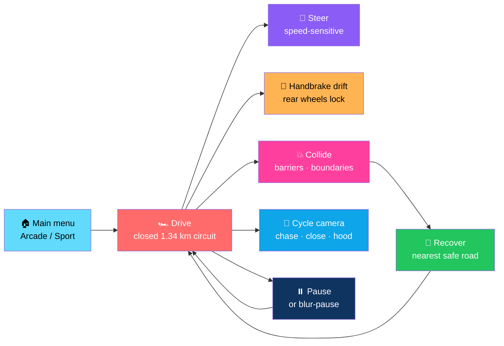
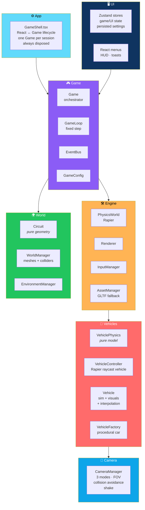

# 🏎️ STREETVERSE

<div align="center">


**A browser-based 3D driving game.**

*Custom raycast vehicle physics · Rapier simulation · Procedural assets · Fully tested*

[🚀 Run](#-run) • [🎮 Controls](#-controls) • [🏗️ Architecture](#-architecture) • [🧪 Testing](#-testing--what-was-actually-run) • [📊 Status](#-status)

</div>

---

## 📖 Overview

**STREETVERSE** is a **browser-based 3D driving game** built with **React + TypeScript + Three.js + Rapier**.

### ⚠️ Current Scope

> **This repository currently implements Stage 1 of the plan: a playable driving prototype.**
>
> **Stages 2–7** *(city districts, traffic, missions, garage/economy, saves, audio, mobile controls, polish)* **are NOT built yet** — **see [Status](#-status).**

### Core Idea

> **Physics-first. Real simulation, not fake motion.**
>
> **A custom raycast vehicle on a Rapier rigid body** — **not Rapier's built-in controller.** Tire forces, weight transfer, and body roll all come from **real physics**, not animation.

### The Stage-1 Experience



---

## 🚀 Run

```bash
npm install
npm run dev        # development server
npm run build      # type-check + production build -> dist/
npm run preview    # serve the production build on :4173
npm run lint
npm test           # unit tests (Vitest, real Rapier physics in Node)
npm run test:e2e   # browser tests (Playwright; builds + serves the app itself)
```

### 🌐 Playwright Browser

> **Playwright needs a Chromium.**
>
> **It uses `CHROME_PATH` if set** — **otherwise looks in `PLAYWRIGHT_BROWSERS_PATH`, `/opt/pw-browsers`, and the Puppeteer cache** — **otherwise Playwright's own download** *(`npx playwright install chromium`)*.

### 🔍 Debug Mode

> **Append `?debug` to the URL** to show an **FPS counter** and expose **`window.__SV_DEBUG__`** *(used by the E2E tests)*.

---

## 🎮 Controls

<div align="center">

| Key | Action |
|:---:|--------|
| **W / ↑** | Accelerate |
| **S / ↓** | Brake — **hold from standstill to reverse** |
| **A D / ← →** | Steer |
| **Space** | **Handbrake** — **locks rear wheels → drift** |
| **C** | Cycle camera — **chase → close chase → hood** |
| **R** | **Recover car** to the nearest safe road position |
| **Esc** | Pause / resume — **also pauses on window blur** |

</div>

> 💡 **Driving mode *(Arcade / Sport)* is chosen on the main menu or pause menu — and is remembered.**

---

## 🏗️ Architecture

### System Overview



### 📂 Project Structure

```
src/
├── app/
│   └── GameShell.tsx      React ↔ Game lifecycle
│                          (one Game per session, always disposed)
│
├── game/                  Game (orchestrator) · GameLoop (fixed step)
│                          EventBus · GameConfig
│
├── engine/                PhysicsWorld (Rapier) · Renderer
│                          InputManager · AssetManager
│
├── vehicles/              VehiclePhysics (pure model)
│                          VehicleController (Rapier raycast vehicle)
│                          Vehicle (sim + visuals + interpolation)
│                          VehicleFactory (procedural car)
│
├── camera/
│   └── CameraManager      3 modes · FOV · collision avoidance · shake
│
├── world/                 Circuit (pure geometry)
│                          WorldManager (meshes + colliders)
│                          EnvironmentManager
│
├── store/                 Zustand stores
│                          (game/UI state, persisted settings)
│
└── ui/                    React menus · HUD · toasts
                           (the 3D canvas is separate from UI layout)

tests/
├── unit/                  Vitest: vehicle behaviour
│                          physics model · input · circuit
└── e2e/                   Playwright: real-browser gameplay flows
```

### 🎯 Key Decisions

<div align="center">

| Decision | Implementation |
|:--------:|---------------|
| **⏱️ Fixed-timestep physics** | **120 Hz** with **render interpolation** — **simulation is separate from rendering** |
| **🚗 Custom raycast vehicle** | On a **Rapier rigid body** — **not Rapier's controller.** **Each wheel has a spring/damper and an anti-roll bar** |
| **🛞 Friction ellipse** | Tire force limited by `mu × load` — **throttle reduces cornering grip**, **handbrake locks the rear tires**, **surface type scales grip** |
| **⚖️ Real weight transfer** | **Weight transfer and body roll come from the real forces** |
| **🎯 Speed-sensitive steering** | **Limited to what the tires can sustain** · **widened during slides** so you can counter-steer |
| **🎮 Two driving modes** | **Arcade vs Sport** differ in **grip, steering assist, damping, and a yaw stabiliser** |
| **📦 Instanced rendering** | Barriers, streetlights, and trees are **instanced** — **colliders are batched on one fixed body each** · **object counts are fixed at build time** |
| **🎨 Procedural assets only** | **No external files** — **`AssetManager.loadGLTF` already falls back to a procedural model on failure**, ready for real models in Stage 2 |

</div>

---

## 🧪 Testing — What Was Actually Run

> **Every check below was run and passed.**

<div align="center">

| Suite | Result |
|:-----:|:------:|
| **`tsc --noEmit`** *(strict, `noUncheckedIndexedAccess`)* | ✅ **Clean** |
| **`eslint .`** | ✅ **Clean** |
| **`vitest run`** | ✅ **39 / 39 passing** |
| **`playwright test`** *(headless Chrome, software WebGL)* | ✅ **13 / 13 passing** |
| **`vite build`** | ✅ **Succeeds** |

</div>

### 🧪 Unit Tests — Real Rapier, Headless

**The unit tests drive the REAL Rapier simulation headlessly.**

<div align="center">

| Area | Coverage |
|------|:--------:|
| **Ride height** | ✅ |
| **Determinism** | ✅ |
| **0–100 km/h time** | ✅ |
| **Gear shifting** | ✅ |
| **Braking distance** | ✅ |
| **Reverse** | ✅ |
| **No-creep** | ✅ |
| **Grip-dependent braking** | ✅ |
| **Steering direction and speed-sensitivity** | ✅ |
| **No rollover under full lock** *(both modes)* | ✅ |
| **~1 g cornering** | ✅ |
| **Handbrake drift** | ✅ |
| **Sport vs Arcade difference** | ✅ |
| **Wall impact without tunnelling** | ✅ |
| **Overturn detection and recovery** | ✅ |

</div>

> 💡 **The suite was mutation-checked** — **breaking the steering sign, removing the brakes, or removing ground contact makes it fail.**

### 🌐 E2E Tests — Real Keyboard, Real Browser

<div align="center">

| Scenario | Coverage |
|----------|:--------:|
| **Boot with a clean console** | ✅ |
| **Accelerate · brake · reverse** | ✅ |
| **Steer** | ✅ |
| **Drift + HUD badge** | ✅ |
| **Camera cycling** | ✅ |
| **Pause / resume** — sim frozen, keys cleared | ✅ |
| **Blur-pause** | ✅ |
| **Manual and automatic recovery** | ✅ |
| **World-boundary collision** | ✅ |
| **Full dispose with no geometry/texture growth across sessions** | ✅ |
| **Canvas resize** | ✅ |
| **Settings persistence** | ✅ |

</div>

---

## 📊 Status

### ✅ Stage 1 Exit Condition Met

> **The player can drive a closed 1.34 km circuit, steer, collide with barriers/boundaries, recover, and pause.**

### ❌ Not Implemented Yet *(Everything After Stage 1)*

<div align="center">

| Feature | Status |
|:-------:|:------:|
| **City districts and buildings** | ❌ |
| **Traffic and pedestrians** | ❌ |
| **Minimap / map / route planning** | ❌ |
| **Missions and rewards** | ❌ |
| **Economy** | ❌ |
| **Dealership** | ❌ |
| **Garage and upgrades** | ❌ |
| **Save system** | ❌ |
| **Audio** | ❌ |
| **Day/night and weather** | ❌ |
| **Graphics presets** | ❌ |
| **Post-processing** | ❌ |
| **Touch controls** | ⚠️ **`InputManager` accepts touch input — but there is no on-screen UI** |
| **Nitro** | ⚠️ **The input exists — but nothing grants it** |
| **Tire smoke / skid marks** | ⚠️ **Per-wheel slip is already computed** |
| **Headlight beams** | ⚠️ **Lights are emissive only** |

</div>

> ⚠️ **We'd rather list what isn't there than ship a fake button.**

---

## ⚠️ Known Limitations

<div align="center">

| Limitation | Details |
|-----------|---------|
| **🎮 GPU performance unmeasured** | **The only renderer available during development was software (SwiftShader), which ran at ~1 fps — not representative.** **The scene is small** *(≈118 draw calls incl. shadows, ≈84k triangles, 33 geometries, 7 textures)* — **but 60 fps has NOT been verified** |
| **🛡️ Slow-condition safety** | **In slow conditions the simulation slows down rather than spiralling** *(capped at 6 substeps per frame)* |
| **⌨️ Held keys cleared after pause** | After pausing, held keys must be re-pressed — **held state is intentionally cleared to avoid stuck controls** |
| **📏 Short first straight** | Only **~60 m** before the first bend — **at full throttle you reach the curb in ~4 s** |
| **🔄 Rollover test granularity** | The unit tests **do not detect changes to the height at which tire forces are applied** *(a deliberate mutation there was not caught)* — **rollover resistance is only checked at a coarse level** |
| **🔍 Debug hooks** | **`window.__SV_DEBUG__`** is enabled **in dev builds and with `?debug`** |

</div>

---

## 🚢 Deployment

> **`npm run build` produces a static site in `dist/`.**
>
> **Upload it to any static host** — **Netlify, Vercel, GitHub Pages, S3 + CDN**.
>
> **No backend or paid service is required.**

---

## 🎨 Asset Credits

> **None required: all geometry and textures are generated procedurally at runtime.**

> 💡 **Vehicle name "Kestrel S1" is fictional.**

---

## 🗺️ Roadmap

### ✅ Stage 1 — Current

- [x] React + TypeScript + Vite foundation
- [x] Three.js rendering with Rapier physics
- [x] Fixed-timestep physics at 120 Hz with render interpolation
- [x] Custom raycast vehicle on a Rapier rigid body
- [x] Per-wheel spring/damper with anti-roll bar
- [x] Friction ellipse — throttle reduces cornering grip, handbrake locks rear tires, surface type scales grip
- [x] Real weight transfer and body roll
- [x] Speed-sensitive steering widened during slides
- [x] Arcade and Sport driving modes with different grip, steering assist, damping, and yaw stabiliser
- [x] Three camera modes — chase, close chase, hood
- [x] Camera FOV, collision avoidance, and shake
- [x] Closed 1.34 km circuit with pure-geometry Circuit module
- [x] World meshes and colliders via WorldManager
- [x] Instanced rendering for barriers, streetlights, and trees with batched colliders
- [x] Procedural vehicle and world assets — zero external files
- [x] AssetManager GLTF fallback ready for Stage 2
- [x] Accelerate, brake, reverse, steer, and handbrake drift
- [x] Manual and automatic recovery to nearest safe road
- [x] Pause, resume, and blur-pause with held-key clearing
- [x] Zustand stores for game/UI state with persisted settings
- [x] React menus, HUD, and toasts separate from the 3D canvas
- [x] `?debug` FPS counter and `window.__SV_DEBUG__` hook
- [x] Playwright with flexible Chromium discovery
- [x] `tsc --noEmit` strict clean
- [x] ESLint clean
- [x] 39 unit tests passing against real Rapier
- [x] Mutation-checked test suite — steering sign, brakes, ground contact
- [x] 13 Playwright E2E tests passing in a real browser
- [x] Production build succeeds
- [x] Fully static output — deployable to any static host
- [x] No backend or paid service required

### 🔜 Stage 2+

- [ ] **City districts and buildings**
- [ ] **Traffic and pedestrians**
- [ ] **Minimap, map, and route planning**
- [ ] **Missions and rewards**
- [ ] **Economy and dealership**
- [ ] **Garage and upgrades**
- [ ] **Save system**
- [ ] **Audio**
- [ ] **Day/night and weather**
- [ ] **Graphics presets and post-processing**
- [ ] **On-screen touch controls** — `InputManager` already accepts touch
- [ ] **Nitro** — input exists, needs a grant mechanism
- [ ] **Tire smoke and skid marks** — per-wheel slip is already computed
- [ ] **Headlight beams** — currently emissive only

---

## 🤝 Contributing

Contributions are welcome. Please:

1. Fork the repository
2. **Keep simulation separate from rendering** — fixed-step physics, interpolated rendering
3. **Keep physics real** — weight transfer and body roll must come from forces, not animation
4. **Add tests for any vehicle or physics change** — the suite is mutation-checked
5. **Add Playwright tests for any new browser behavior**
6. **Keep assets procedural** — no external files
7. **Preserve the GLTF fallback** — real models must remain optional
8. **Keep the dispose contract** — one `Game` per session, always disposed, no leaked geometries or textures
9. **Update the Status section** when you complete a stage
10. Submit a Pull Request

### Guidelines

- **Never claim 60 fps** without a real-GPU measurement
- **Never fake physics** — the simulation is the product
- **Never break the dispose contract** — memory must not grow across sessions
- **Never present a stub as a feature** — the **Status** and **Known Limitations** sections are the standard
- **Never skip `tsc --noEmit`** — strict mode is the contract

---

## 📜 License

MIT — see [LICENSE](LICENSE) for details.

---

## 🙏 Acknowledgments

- **Rapier** — for physics that lets a custom vehicle feel real
- **Three.js** — for rendering that stays out of the physics' way
- **The mutation-checked test suite** — for making "it works" a fact, not a claim
- **Every driving game that ever made you chase a perfect lap** — this one's for you

---

<div align="center">

### 🏎️ ACCELERATE. STEER. DRIFT. RECOVER.

**A browser-based 3D driving game.**

**Real physics. Procedural assets. Fully tested.**

<br>

> ⚠️ **Stage 1 of 7. 60 fps on a real GPU is unmeasured.**

<br>

⭐ If STREETVERSE took you for a drive, consider giving it a star.

<br>

[⬆ Back to Top](#️-streetverse)

</div>
